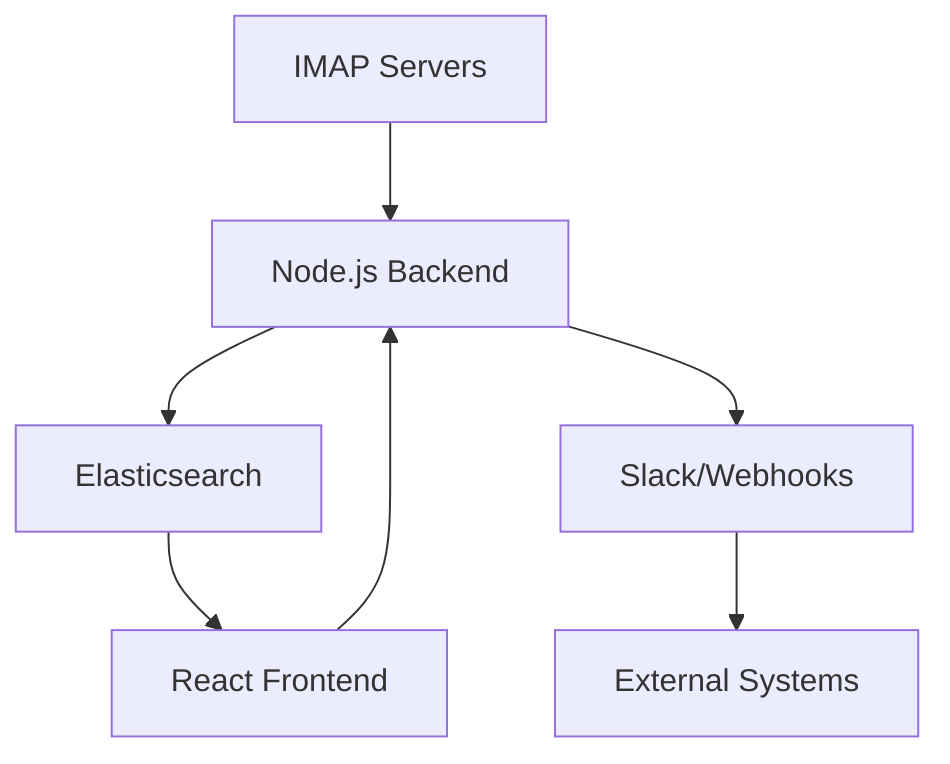

# AI-Powered Onebox Aggregator

An email intelligence engine that aggregates IMAP streams, categorizes messages with Gemini, and indexes them in Elasticsearch.

## 🚀 Overview

The Onebox Aggregator synchronizes multiple IMAP streams into a unified processing pipeline. It uses Elasticsearch for full-text and structured search, plus in-memory similarity over predefined templates when generating suggested replies.

## 🛠 Tech Stack

- **Runtime**: Node.js
- **Search Engine**: Elasticsearch (Full-text & Structured Search)
- **Intelligence**: Google Gemini AI (email categorization, RAG-powered reply suggestions)
- **Email Protocol**: IMAP with IDLE support for real-time streaming
- **Infrastructure**: Docker & Docker Compose

## 🏗 System Architecture



## ✨ Key Features

- **Real-time Streaming**: Utilizes IMAP IDLE to listen for new incoming emails.
- **Search and reply context**:
  - **Elasticsearch**: Handles complex filtering, date ranges, and exact-match queries.
  - **In-memory templates**: Selects similar predefined response templates to provide reply context during the running process.
- **AI-Driven Intelligence**:
  - **Email categorization**: Uses Gemini to classify incoming messages.
  - **RAG-powered reply suggestions**: Retrieves the most similar templates from an in-memory embedding store (Gemini embeddings + cosine similarity) and uses them as context for Gemini to draft a reply.

## 📦 Getting Started

### Prerequisites

- Docker and Docker Compose
- Node.js (v18+)
- Google Gemini API Key

### Installation

1. Clone the repository:
   ```bash
   git clone https://github.com/ayush-sharaf/onebox-aggregator.git
   cd onebox-aggregator
   ```

2. Configure environment variables:
   Create a `.env` file in the root directory:
   ```env
   GEMINI_API_KEY=your_key_here
   ELASTICSEARCH_URL=http://localhost:9200
   ```

3. Spin up the infrastructure:
   ```bash
   docker-compose up -d
   ```

4. Install dependencies and start the backend:
   ```bash
   cd backend
   npm install
   npm start
   ```
