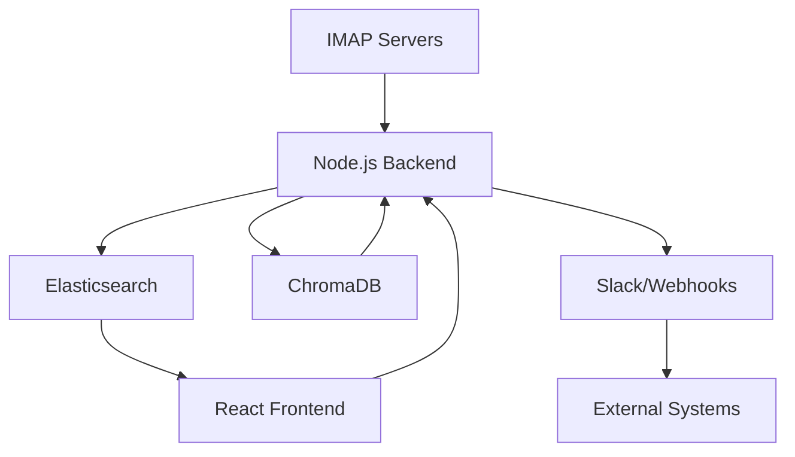

# AI-Powered Onebox Aggregator

A high-performance email intelligence engine designed to aggregate and process real-time IMAP streams with AI-driven categorization and hybrid search capabilities.

## 🚀 Overview

The Onebox Aggregator is a sophisticated backend industrial engine that synchronizes multiple IMAP streams into a unified processing pipeline. It combines traditional full-text search with modern vector-based semantic search to provide an unparalleled email retrieval experience.

## 🛠 Tech Stack

- **Runtime**: Node.js
- **Search Engine**: Elasticsearch (Full-text & Structured Search)
- **Vector Database**: ChromaDB (Semantic Vector Search)
- **Intelligence**: Google Gemini AI (RAG, Thread Summarization, Auto-categorization)
- **Email Protocol**: IMAP with IDLE support for real-time streaming
- **Infrastructure**: Docker & Docker Compose

## 🏗 System Architecture



## ✨ Key Features

- **Real-time Streaming**: Utilizes IMAP IDLE to listen for new incoming emails with sub-second latency.
- **Hybrid Search Pipeline**:
  - **Elasticsearch**: Handles complex filtering, date ranges, and exact-match queries.
  - **ChromaDB**: Powering semantic search to find emails based on meaning rather than just keywords.
- **AI-Driven Intelligence**:
  - **RAG (Retrieval-Augmented Generation)**: Answers queries based on actual email context using Gemini Pro.
  - **Automated Thread Recovery**: Intelligently groups fragmented messages into cohesive conversations.
  - **Smart Replies**: Suggests contextually relevant responses based on thread history.
- **Microservices Ready**: Architected for scalability with Dockerized components.

## 📦 Getting Started

### Prerequisites

- Docker and Docker Compose
- Node.js (v18+)
- Google Gemini API Key

### Installation

1. Clone the repository:
   ```bash
   git clone https://github.com/ayush-sharaf/onebox-aggregator.git
   cd onebox-aggregator
   ```

2. Configure environment variables:
   Create a `.env` file in the root directory:
   ```env
   GEMINI_API_KEY=your_key_here
   ELASTICSEARCH_URL=http://localhost:9200
   CHROMADB_URL=http://localhost:8000
   ```

3. Spin up the infrastructure:
   ```bash
   docker-compose up -d
   ```

4. Install dependencies and start the backend:
   ```bash
   cd backend
   npm install
   npm start
   ```

## 🛡 License

This project is licensed under the MIT License - see the [LICENSE](LICENSE) file for details.
