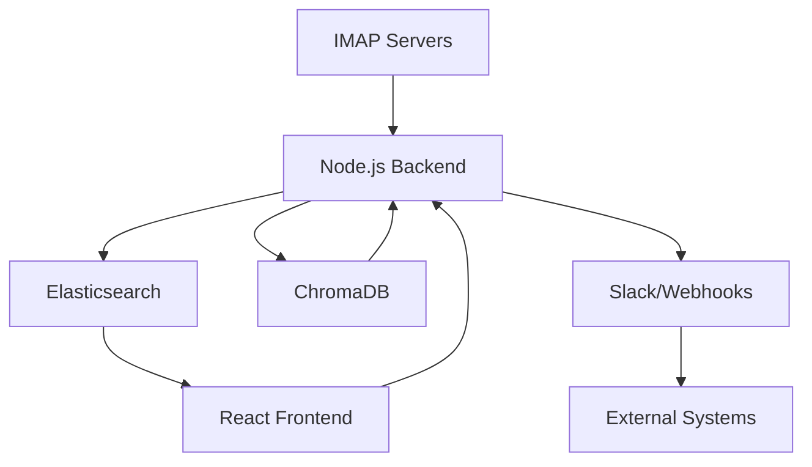

# Email Onebox Aggregator

A feature-rich email management system with AI-powered categorization and response suggestions.

## Features

- 📨 **Real-time Email Sync** - IMAP IDLE mode for instant updates
- 🔍 **Advanced Search** - Elasticsearch-powered email search
- 🤖 **AI Categorization** - Automatic email labeling
- 💬 **Smart Replies** - RAG-powered response suggestions
- 🔔 **Notifications** - Slack/webhook integrations
- 🖥️ **Dashboard** - Clean UI for email management

## Architecture



## Tech Stack

- **Backend**: Node.js, TypeScript, Express
- **Database**: Elasticsearch (email storage), ChromaDB (vector store)
- **AI**: Google Gemini 1.5 Flash
- **Frontend**: React, Material-UI
- **Infra**: Docker, Docker Compose

## Setup Instructions

### Prerequisites

- Node.js 18+
- Docker Engine
- Google Cloud API key
- IMAP-enabled email accounts

### 1. Backend Setup

```bash
cd backend
cp .env.example .env
# Edit .env with your credentials
npm install
npm run build
npm start
```

### 2. Database Services

```bash
docker-compose up -d elasticsearch chromadb
```

### 3. Frontend Setup

```bash
cd frontend
cp .env.example .env
npm install
npm run dev
```

### 4. Initial Configuration

1. Access Elasticsearch at `http://localhost:9200`
2. ChromaDB dashboard at `http://localhost:8000`
3. Frontend at `http://localhost:5173`

## Environment Variables

### Backend (.env)

```ini
IMAP1_USER=your_mail1
IMAP1_PASSWORD=pass1
IMAP1_HOST=imap_host1
IMAP1_PORT=imap_port1
IMAP1_TLS=true

IMAP2_USER=your_mail2
IMAP2_PASSWORD=pass2
IMAP2_HOST=imap_host2
IMAP2_PORT=imap_port2
IMAP2_TLS=true

ELASTICSEARCH_HOST=http://localhost:9200
SLACK_WEBHOOK_URL=slack webhook url
WEBHOOK_SITE_URL=webhook site url

GEMINI_API_KEY=gemini_api_key

CHROMA_SERVER_HOST=chroma
CHROMA_SERVER_HTTP_PORT=8000
```

## API Endpoints

| Endpoint | Method | Description |
|----------|--------|-------------|
| `/api/emails` | GET | Get all emails |
| `/api/emails/search` | GET | Search emails |
| `/api/emails/:id/suggest-reply` | POST | Get AI reply suggestion |

## Deployment

Production deployment with Docker:

```bash
docker-compose -f docker-compose.prod.yml up --build -d
```

## Troubleshooting

**Q: IMAP connection fails**
```bash
# Test IMAP connection manually
openssl s_client -connect imap.example.com:993 -crlf
```

**Q: ChromaDB won't start**
```bash
# Alternative local ChromaDB
pip install chromadb
python -m chromadb run --path /db_data
```

